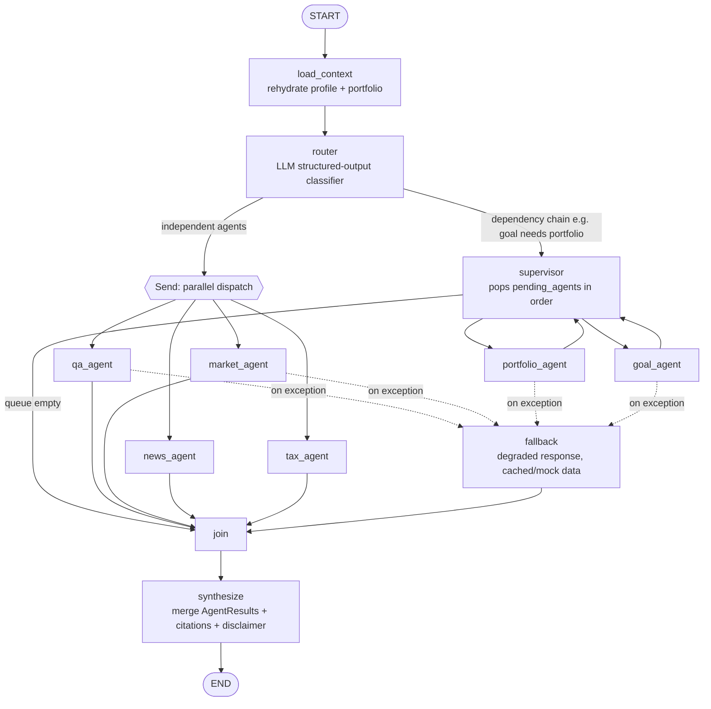

# LangGraph Workflow & Agent Boundaries

Status: design draft, no code yet.
Scope: this covers orchestration and agent responsibilities only — the two rubric
line items worth the most (Multi-Agent Architecture 10%, LangGraph Workflow 10%).
RAG internals, market-data caching, and the Streamlit UI get their own design
notes later and are only referenced here where they touch the graph.

## 1. Goals this design is optimizing for

The rubric's top band for these two criteria asks for: all 6 agents, "sophisticated
inter-agent communication," "advanced state management," and orchestration that
handles compound queries — not just a single dispatch-and-return router. Everything
below is shaped to hit those explicitly, not just to be "clean."

Decision: build all 6 agents, but treat them in two tiers so effort matches risk:

| Tier | Agents | Why |
|---|---|---|
| Core (full custom logic) | Finance Q&A, Portfolio Analysis, Market Analysis, Goal Planning | These are the ones with real calculation/tool logic and the ones the FAQ names as priority. |
| Light (RAG-only, reuse Q&A's retriever with a category filter + a specialized prompt) | News Synthesizer, Tax Education | Gets us to "all 6 agents with distinct functionality" for the top rubric band without splitting focus away from the four agents that carry the most domain-knowledge grading (20%) and the ones users will exercise most in the demo. News additionally calls a lightweight news-fetch tool; Tax stays pure RAG over a `tax` category in the knowledge base. |

If this trade-off is wrong for how the demo video is scripted, it's cheap to
upgrade News/Tax later — they already exist as graph nodes with the shared
contract, they'd just get their own tools instead of RAG-only.

## 2. Agent boundaries

Each agent is a LangGraph node. It receives the shared `AgentState`, does one job,
and returns a structured `AgentResult` (contract in §5) — it never calls another
agent directly. Cross-agent dependencies go through the supervisor (§4), not
agent-to-agent calls.

| Agent | Responsibility | Reads from state | Tools | Writes to state |
|---|---|---|---|---|
| **Finance Q&A** | General financial education, jargon-free explanations | `messages`, `user_profile.experience_level` | RAG retriever (all categories) | `agent_outputs["qa"]`, `retrieved_docs` |
| **Portfolio Analysis** | Parse holdings, compute allocation/diversification/risk metrics | `portfolio`, `messages` | portfolio calculator (pure functions), market-data tool (current prices for held tickers) | `agent_outputs["portfolio"]`, `portfolio.metrics` |
| **Market Analysis** | Live quotes, trend summary for named tickers/indices | `messages` (extracted tickers) | market-data tool (yfinance/Alpha Vantage, cached) | `agent_outputs["market"]`, `market_data` |
| **Goal Planning** | Projections toward a stated goal given risk tolerance and (if available) portfolio | `user_profile.{risk_tolerance,goals}`, `portfolio.metrics` (if already computed this turn) | projection calculator (compound growth, Monte-Carlo-lite), risk profiler | `agent_outputs["goal"]` |
| **News Synthesizer** *(light)* | Summarize/contextualize recent market-relevant news for a topic/ticker | `messages`, `market_data` | RAG retriever (`news` category) + news-fetch tool | `agent_outputs["news"]` |
| **Tax Education** *(light)* | Explain account types (401k/IRA/etc.), tax concepts — education only, never filing advice | `messages` | RAG retriever (`tax` category) | `agent_outputs["tax"]` |

Boundary rule: only Portfolio and Market ever call the market-data tool directly
(Goal reads the *result*, already in state, rather than re-fetching) — this is
what keeps rate-limit/caching logic in one place instead of six.

## 3. Shared state schema

```python
class UserProfile(TypedDict):
    session_id: str
    experience_level: Literal["beginner", "intermediate", "advanced"]
    risk_tolerance: Literal["conservative", "moderate", "aggressive"] | None
    goals: list[FinancialGoal]          # persisted across turns, not just this graph run

class AgentResult(TypedDict):
    agent: str
    summary: str                        # natural-language, ready to be quoted by the synthesizer
    data: dict[str, Any]                # structured payload (metrics, quotes, projections)
    citations: list[Citation]           # RAG source docs or data-provider attribution
    confidence: float
    degraded: bool                      # True if this ran on fallback/cached data

class AgentState(TypedDict):
    messages: Annotated[list[BaseMessage], add_messages]
    user_profile: UserProfile
    portfolio: Portfolio | None
    intent: list[str]                   # router's classification output, ordered
    pending_agents: list[str]           # supervisor's dispatch queue for this turn
    agent_outputs: dict[str, AgentResult]
    retrieved_docs: list[Document]
    market_data: dict[str, Quote]       # this-turn cache, avoids duplicate fetches across agents
    error: ErrorInfo | None
    final_response: str | None
```

Two separate memory layers, deliberately not conflated:

- **Turn/conversation memory** — `messages`, via a LangGraph checkpointer
  (`SqliteSaver`, keyed by `session_id` as the thread id). This is what makes
  multi-turn context preservation work (rubric: Conversational Flow, 8%).
- **User profile memory** — `user_profile` and `portfolio`, persisted separately
  in `src/core` (SQLite table, not the checkpointer) and *rehydrated into* state
  at the start of every graph invocation. Reasoning: profile/goals/holdings should
  survive a cleared chat or a new session_id (e.g. user starts a fresh
  conversation but the app remembers their risk tolerance); pure checkpointer
  memory wouldn't give us that.

## 4. Graph topology



Node notes:

- **`load_context`**: reads the persisted `UserProfile`/`Portfolio` for
  `session_id` and merges into state before anything else runs. Also where a
  brand-new session gets a default profile (beginner, no risk tolerance set —
  triggers the router to occasionally nudge toward a short risk-tolerance
  question rather than assume one).
- **`router`**: single LLM call with structured output (Pydantic schema, not
  free text) producing `intent: list[str]` from the 6 agent labels, plus a flag
  for whether this is a compound query with a dependency (currently the only
  known dependency is Goal→Portfolio: "how should I adjust my portfolio to hit
  retirement" needs portfolio metrics computed first). The conditional edge
  reads that flag to choose the `Send`-based parallel fan-out vs. the
  supervisor path — not both add complexity to the same query type.
- **`supervisor`**: a small loop node, not an LLM call. Pops the next agent
  from `pending_agents`, invokes it, checks `agent_outputs` for what it needs,
  re-enters the loop until the queue is empty. This is the "advanced state
  management" the rubric is asking for — ordering is explicit and inspectable,
  not implicit in prompt text.
- **`join`**: pure state merge, no LLM call — just confirms all dispatched
  agents (parallel or sequential) have written to `agent_outputs` before
  handing off.
- **`synthesize`**: one LLM call that takes every `AgentResult` for this turn
  and produces the final user-facing message: merges citations, resolves any
  redundancy between agents (e.g. Q&A and Tax both touching IRAs), and appends
  the standing "this is education, not financial advice" disclaimer.
- **`fallback`**: catches exceptions from any core agent (mainly market-data
  failures), writes a `degraded=True` `AgentResult` using cached/mock data with
  a plainly-stated caveat, and rejoins the normal flow — the user always gets a
  complete `synthesize` pass, never a raw stack trace or a silently missing
  section.

## 5. Inter-agent communication protocol

Agents never call each other's code and never read another agent's *prompt* —
only its structured `AgentResult` in `agent_outputs`. This is the contract that
makes the "sophisticated inter-agent communication" claim real rather than
cosmetic:

1. An agent's only output contract is `AgentResult` (§3) — enforced with a
   Pydantic model, not just a TypedDict hint, so a malformed agent response
   fails fast into `fallback` instead of corrupting `synthesize`'s input.
2. Dependencies are declared data, not code calls: Goal Planning doesn't invoke
   Portfolio Analysis — the supervisor guarantees Portfolio runs first and Goal
   reads `agent_outputs["portfolio"].data`. If Portfolio isn't in `pending_agents`
   for this turn (user never mentioned holdings), Goal degrades gracefully to a
   generic projection and says so in its `summary`.
3. Shared read-only resources (`market_data`, `retrieved_docs`) are populated
   once and consulted by multiple agents in the same turn, so Portfolio and
   Market never issue duplicate API calls for the same ticker in one turn.
4. `synthesize` is the only node allowed to produce user-facing prose from
   multiple agents at once — individual agents' `summary` fields are inputs to
   it, not the final response, which is what prevents six agents from
   independently repeating the disclaimer or contradicting each other on the
   same fact.

## 6. Error handling & fallback strategy

- Every core agent's tool calls (market data, RAG retrieval) are wrapped with
  retry + exponential backoff (per the FAQ's guidance) at the tool layer, not
  the graph layer — the graph only sees a clean success or a raised exception.
- Any node exception routes to `fallback` via LangGraph's node-level error
  handling; `fallback` never re-raises — worst case is a degraded answer plus
  a clearly labeled caveat, so a single flaky API call can't break the whole
  turn.
- `error: ErrorInfo | None` in state records what degraded, for logging and for
  an optional "data freshness" indicator in the UI (Milestones doc calls this
  out explicitly for market data).

## 7. Open questions to settle before implementation

- Exact router dependency taxonomy beyond Goal→Portfolio — likely fine to
  start with just that one pair and expand if the demo script needs more.
- Whether `SqliteSaver` checkpointing is worth it over `MemorySaver` for a
  local-deployment-only submission — leaning yes, since "context preservation"
  is graded and surviving an app restart is a cheap way to demonstrate it.
- ~~Where the risk-tolerance/goal-setting *question flow* lives~~ — **resolved**:
  it rides along with the router's LLM structured-output call rather than a
  separate node (`RouterDecision.extracted_goal`/`extracted_risk_tolerance` in
  `workflow/router.py`), merged into the profile and persisted by
  `workflow/graph.py`'s `router_node`. This is one-shot extraction only — it
  doesn't ask a clarifying question if the user's goal is missing an amount,
  which is a real limitation, not a full intake flow. Upgrading to a proper
  multi-turn intake (clarify missing fields, confirm before saving) is a
  legitimate follow-up if the demo script needs it.

## 8. Observability: LangSmith tracing

Every LLM call in this project already goes through LangChain (`ChatOpenAI`,
`.with_structured_output()`, `langchain_core.messages`) — see the router's
own docstring in `workflow/router.py` for where each integration point is.
That means LangSmith tracing needs **no new code to turn on**, only
environment variables (see `.env.example`): `LANGSMITH_TRACING=true`,
`LANGSMITH_API_KEY=...`, `LANGSMITH_PROJECT=...`. Once set, every
`ChatOpenAI` call, every `OpenAIEmbeddings` call (RAG retrieval), and every
LangGraph node becomes a trace in the LangSmith dashboard automatically.

What *is* code is the tagging layer that makes those traces legible rather
than an undifferentiated list of anonymous `ChatOpenAI` calls:

- `agents/narration.py`'s `narrate()` takes an optional `agent_name` and
  tags the call as `run_name="{agent}_narration"`, `tags=["agent:{agent}"]`
  — every one of the six agents' narration calls passes its own `self.name`,
  so a trace reads "portfolio_narration" whether it was reached via the
  full graph or a direct Streamlit-tab call to the agent.
- The router's classification call is tagged `router_classify` /
  `tags=["router"]`; `synthesize`'s multi-agent merge call is tagged
  `synthesize_merge` / `tags=["synthesize"]`.
- The Streamlit chat tab's outer `graph.invoke()` call is tagged
  `chat_turn`, `tags=["web_app", "chat_tab"]`, with the signed-in username
  as trace metadata (see `core/auth.py` for why there's a real username to
  attach, not an anonymous session id).
- `web_app/app.py` and `mcp_server.py` each set a default
  `LANGSMITH_PROJECT` (`finnie-webapp` / `finnie-mcp`) via
  `os.environ.setdefault`, so the two entry points' traces group separately
  in the dashboard by default without overriding an explicit choice in `.env`.

This is deliberately observability-only: no evaluation harness is wired up
here (LangSmith's Datasets & Evaluations feature is a separate, larger
piece of work — porting `tests/rag/eval_queries.jsonl` into a LangSmith
dataset and running `langsmith.evaluate()` against the router/RAG/agents
would be the natural next step if that's wanted).

Next: RAG implementation design (retriever, chunking, category filters,
citation format) and the market-data caching/rate-limit design, since both are
referenced here but owned elsewhere.
