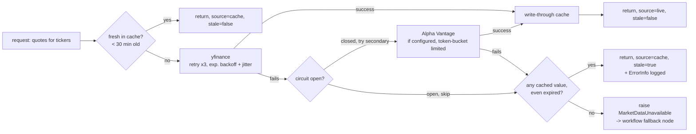

# Market Data Integration Design

Status: design draft, no code yet.
Scope: live quotes, history, fund metadata, and news headlines — the tool
layer that [`langgraph-workflow.md`](./langgraph-workflow.md) calls "the
market-data tool" and restricts to the Portfolio and Market agents (Goal
reads results already in state; it never fetches directly). Targets
Real-time Data Integration (7%) and feeds Portfolio Analysis (7%) and Market
Intelligence (5%).

## 1. Provider choice: yfinance primary, Alpha Vantage optional secondary

The Milestones doc lists both as acceptable. The deciding factor is Alpha
Vantage's current free tier: **25 requests/day**, which is unworkable as a
primary source — a single portfolio-analysis call over 8 holdings plus a
market-overview refresh would burn a third of the daily quota in one user
turn. yfinance (unofficial Yahoo Finance access, no key, no published hard
limit) is the practical choice for a demo with real interactive traffic.

Decision: **yfinance is the only provider required for v1.** Alpha Vantage is
designed in as an optional secondary behind the same interface (§3) so it can
be wired in later without changing any agent code, but it's not blocking —
worth revisiting only if yfinance proves unreliable in practice, since it's
an unofficial/scraping-based API that Yahoo can rate-limit or change without
notice.

Bonus reason yfinance fits better here specifically: it exposes fund/ETF
`info` (including expense ratio) and a per-ticker `.news` property, so it
covers three needs — quotes, the expense-ratio metric the Milestones FAQ
calls out for Portfolio Analysis, and a source for the News agent's
headlines — without needing a separate news API key at all.

## 2. Data contracts

```python
class Quote(TypedDict):
    ticker: str
    price: float
    change: float
    change_percent: float
    currency: str
    as_of: datetime          # when this value was actually fetched
    source: Literal["live", "cache"]
    stale: bool              # True if served past cache_ttl_minutes

class HistoricalBar(TypedDict):
    ticker: str
    date: date
    close: float

class FundInfo(TypedDict):
    ticker: str
    name: str
    asset_class: Literal["equity", "bond", "etf", "mutual_fund", "cash", "other"]
    expense_ratio: float | None
    category: str | None      # e.g. "Large Blend" for a fund

class NewsItem(TypedDict):
    ticker: str
    headline: str
    url: str
    published_at: datetime
```

`Quote.stale`/`source` are the "data freshness indicators" the Milestones FAQ
calls for — they're not an afterthought, they flow straight into the UI (a
"prices as of 2:45 PM" vs. "showing last known price from this morning —
market data temporarily unavailable" distinction) and into
`AgentResult.degraded` from the workflow doc.

## 3. Provider abstraction

```python
class MarketDataProvider(Protocol):
    def get_quotes(self, tickers: list[str]) -> dict[str, Quote]: ...
    def get_history(self, ticker: str, period: str) -> list[HistoricalBar]: ...
    def get_fund_info(self, ticker: str) -> FundInfo | None: ...
    def get_news(self, ticker: str, limit: int = 5) -> list[NewsItem]: ...
```

`YFinanceProvider` implements this now. `AlphaVantageProvider` implements the
same protocol later if needed — agents and the caching layer never see which
one answered. Tests use a third implementation, `FakeProvider`, returning
fixed data so unit tests never touch the network or a real quota (§8).

For multi-ticker calls (Portfolio Analysis over N holdings), `YFinanceProvider`
uses yfinance's batch download (`yf.Tickers`) to fetch all tickers in one
round trip rather than N separate calls — matters both for latency and for
staying under whatever informal throttling Yahoo applies.

## 4. Resilience chain



Layer-by-layer:

1. **Cache check** — in-memory `TTLCache` (per-process, `cache_ttl_minutes`
   default 30 per the FAQ's recommendation), backed by a SQLite table for
   cross-restart persistence and as the source for the "stale" tier below.
   Cache key is `(ticker, data_type)`.
2. **Primary provider** — yfinance, retried up to 3 times with exponential
   backoff + jitter (base 0.5s) on transient failures (timeouts, 429s).
3. **Circuit breaker** — if yfinance has failed repeatedly in the last
   cool-down window (5 min default), skip straight past it instead of
   spending 3 retries per request during an outage; same treatment applies to
   Alpha Vantage's daily quota (breaker opens the moment a 429/quota response
   is seen, since retrying there just burns quota faster).
4. **Secondary provider** (only if configured) — Alpha Vantage, behind its own
   token-bucket limiter (5 calls/min) so a burst of agent calls can't blow the
   daily quota in one turn.
5. **Stale-cache fallback** — if both providers fail, serve the last known
   value from the SQLite-backed cache regardless of age, marked
   `stale=True`, and record an `ErrorInfo` in `AgentState.error` so the
   workflow's `fallback` node (per the workflow doc's §6) can produce a
   plainly-caveated response instead of failing the turn.
6. **True cold start** — no cached value exists at all *and* both providers
   are down. This is the one case worth a deliberate call: **don't fabricate
   a plausible-looking live price.** The problem statement's own "User Trust"
   section warns about this directly — a fake number presented with the same
   confidence as a real one is worse for trust than a clear "unavailable"
   message. Instead, ship a small **seed cache**: a checked-in JSON snapshot
   of ~15-20 common tickers (major indices, a handful of large-cap stocks,
   a couple of broad ETFs) with an honest, clearly-old `as_of` timestamp,
   loaded into the SQLite cache on first run. That gives the demo something
   to show even fully offline, without pretending it's live. Anything not in
   the seed set with no cache and no provider raises `MarketDataUnavailable`,
   which the workflow's `fallback` node turns into an honest "I can't get a
   current price for X right now" rather than a silent guess.

## 5. Rate limiting & backoff specifics

| Provider | Limiter | Backoff on failure |
|---|---|---|
| yfinance | soft self-throttle: min 200ms between individual (non-batched) requests | exponential, base 0.5s, factor 2, max 3 attempts, ±20% jitter |
| Alpha Vantage (optional) | token bucket, 5/min and a hard daily counter at 25 | no retry on 429 — that's a quota signal, not a transient error; open the breaker immediately |

Config surface (`config.yaml`):

```yaml
market_data:
  primary_provider: yfinance
  secondary_provider: null        # set to alpha_vantage to enable
  cache_ttl_minutes: 30
  request_timeout_seconds: 10
  max_retries: 3
  backoff_base_seconds: 0.5
  circuit_breaker_cooldown_seconds: 300
  alpha_vantage_rate_limit_per_minute: 5
  alpha_vantage_daily_limit: 25
```

`ALPHA_VANTAGE_API_KEY` isn't in `.env`/`.env.example` yet — not adding it
until/unless the secondary provider is actually wired in, per the "not
blocking for v1" decision in §1.

## 6. Long-run return assumptions aren't a live-data problem

Worth being explicit: Goal Planning's projections need an assumed long-run
rate of return per asset class, and that number does **not** come from
yfinance or any live API — no provider hands you "expected future return."
These are static, documented assumptions (e.g. "historical US equity real
return ≈ 7%," sourced from the `risk_and_diversification` knowledge-base
category from the RAG design) stored in config, not fetched. Calling this out
now so it doesn't get implemented later as an ad-hoc API call to the wrong
kind of data source — conflating "current price" with "expected future
return" is exactly the kind of overclaiming the problem statement's
regulatory-compliance section warns against.

## 7. Mapping to agents

Reaffirms the boundary rule from the workflow doc (only Portfolio and Market
call this layer directly):

| Agent | Calls | Purpose |
|---|---|---|
| Market Analysis | `get_quotes` (requested tickers + tracked indices), `get_history` | live quote + trend summary |
| Portfolio Analysis | `get_quotes` (held tickers), `get_fund_info` | current value, asset-class mix, expense ratios |
| Goal Planning | *(none — reads `state.market_data` if Portfolio already ran this turn)* | per the workflow's dependency rule |
| News Synthesizer (light) | `get_news` | headlines; RAG (per the RAG doc) supplies background/glossary context for jargon in them, not the headlines themselves |

## 8. Testing approach

- `FakeProvider` (implements `MarketDataProvider`, returns fixture data) is
  what unit tests for agents and the caching layer use — no network calls in
  CI, no risk of tests silently burning Alpha Vantage's daily quota.
- Targeted tests for the resilience chain itself: cache hit, TTL expiry
  triggers refetch, primary failure falls through to secondary success,
  both fail but a stale cache entry exists (asserts `stale=True` and an
  `ErrorInfo` is recorded), and both fail with nothing cached and no seed
  match (asserts `MarketDataUnavailable` reaches the workflow's fallback path
  rather than propagating as an unhandled exception).
- One real-network smoke test against yfinance, marked so it's skipped in CI
  by default and only run manually — confirms the actual third-party surface
  hasn't changed shape without depending on it for every test run.

## 9. Open questions

- Whether Alpha Vantage is worth wiring in at all before submission, given
  its quota — current lean is no, and to instead spend that time hardening
  the yfinance-only path (batch calls, seed cache, breaker) since that's what
  the demo actually depends on.
- Seed-cache ticker list is a placeholder (~15-20 names) — finalize once the
  sample portfolio data mentioned in the Milestones doc exists, so the seed
  set actually covers whatever the demo portfolio holds.
- Whether index/market-overview tickers (S&P 500, Dow, Nasdaq proxies) need a
  shorter effective TTL than individual stock quotes for the Market tab to
  feel "live enough" — revisit once the Streamlit UI's refresh behavior is
  designed.
